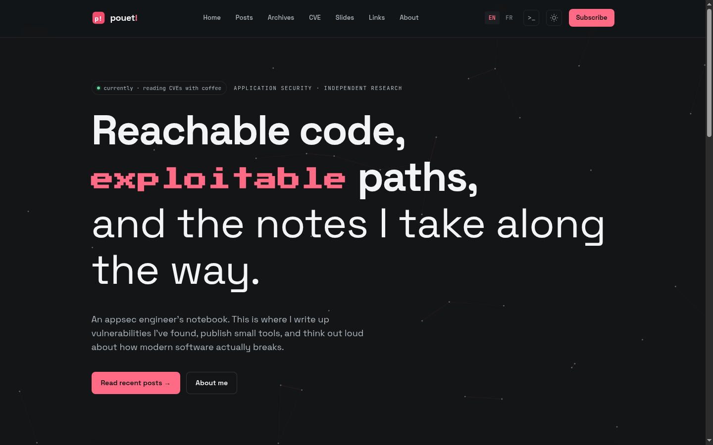
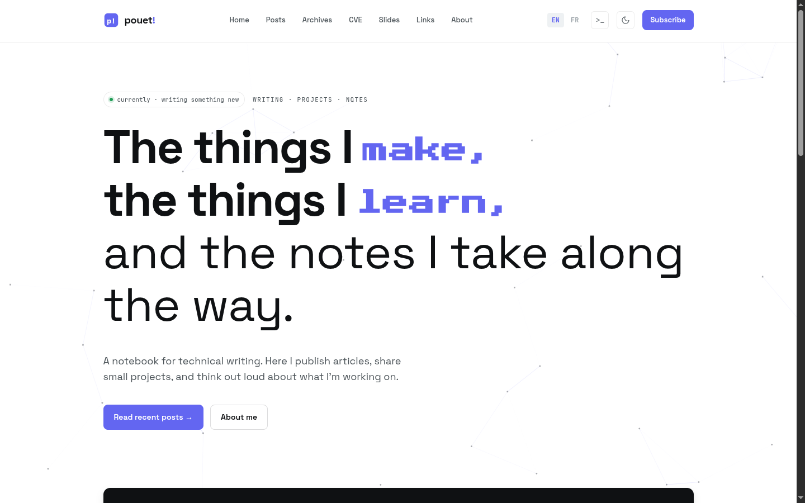

# PouetHugo

[](https://github.com/GRodolphe/PouetHugo/actions/workflows/ci.yml)
[](https://scorecard.dev/viewer/?uri=github.com/GRodolphe/PouetHugo)
[](https://slsa.dev)
[](docs/osps-baseline.md)
[](LICENSE)
[](https://gohugo.io/)

A bilingual (EN + FR) Hugo blog template for technical writing and security research. Extracted from a real production blog, genericized, and documented end to end.

Dark terminal aesthetic, quiet red accents, and a feature set aimed at people who write about code: annotated code blocks, mermaid diagrams, a CVE tracker, an inline PDF slides viewer, and a Ctrl+K command palette.

| Dark | Light |
|---|---|
|  |  |

## Features

- **Bilingual by construction** - separate `content/en` and `content/fr` trees, per-language menus and UI strings, hreflang alternates, one-click language switch. Going monolingual is a deletion, not a refactor.
- **Command palette** - Ctrl+K (or Cmd+K) fuzzy search over a build-time JSON index, plus commands (toggle theme, switch language). No external search service.
- **Hover preview cards** - internal post links show a preview popover fed by the same index.
- **View transitions** - cross-page transitions and a circular theme-toggle wipe via the View Transitions API, with graceful fallback and `prefers-reduced-motion` respected.
- **Dark / light mode** - persisted in localStorage, honors the system preference, themes the mermaid diagrams too.
- **Code blocks for people who read code** - Catppuccin Mocha highlighting via CSS classes, font ligatures disabled so `===` stays three characters.
- **Mermaid diagrams** - fenced ` ```mermaid ` blocks rendered client-side, re-themed live when dark mode flips.
- **Content machinery for security writing** - CVE tracker page driven by `data/cves.yaml`, post chips for `cve` and `postKind`, a slides page with an inline pdf.js viewer, a curated links page with tag filtering.
- **Small touches** - GSAP scroll animations, pixel-canvas background, reading progress bar, cursor tooltips, RSS per language, console easter egg, custom 404.
- **No accounts, no trackers** - analytics are off unless you opt in with a single config key.

## Quickstart

Requirements: [Hugo extended](https://gohugo.io/installation/) ≥ 0.139. Node.js is optional (Cloudflare Pages builds and the test suite).

```bash
# use this repo as a GitHub template ("Use this template" button), then:
git clone https://github.com/<you>/<your-blog>.git
cd <your-blog>
hugo server -D
# http://localhost:1313
```

Make it yours (the full walkthrough is in [docs/getting-started.md](docs/getting-started.md)):

1. `hugo.toml` - title, baseURL, author block. Every key is commented.
2. `i18n/en.toml` + `i18n/fr.toml` - the hero, about page, and footer copy live here as placeholder text. Rewrite them in your voice.
3. `static/img/logo.svg` - replace the placeholder mark.
4. Delete the sample posts in `content/*/posts/` and write your own.

## Project structure

```
content/          # posts + pages, split by language (en/, fr/)
  en/posts/       # page bundles or single .md files
  fr/posts/       # same posts, French
data/             # cves.yaml, slides.yaml
i18n/             # all UI strings (en.toml, fr.toml)
static/           # img/ (logo), slides/ (PDFs)
themes/pouet/     # the theme: layouts, partials, css, js
tests/            # node --test suite for the fuzzy matcher
hugo.toml         # site config - fully commented
build.js          # Cloudflare Pages build helper
```

## Documentation

| Doc | What it covers |
|---|---|
| [Getting started](docs/getting-started.md) | Setup, personalization checklist, first post |
| [Configuration](docs/configuration.md) | Every `hugo.toml` key and where it surfaces |
| [Content](docs/content.md) | Posts, frontmatter, the CVE/slides/links pages, data file schemas |
| [Languages & i18n](docs/i18n.md) | How bilingual works, adding or removing a language |
| [Features](docs/features.md) | Each feature: where it lives, how to customize or disable it |
| [Theming](docs/theming.md) | Design tokens, fonts, syntax colors, logo |
| [Writing guide](docs/writing-guide.md) | The voice and structure conventions the sample content follows |
| [Deployment](docs/deployment.md) | Cloudflare Pages, GitHub Pages, the Hugo version-skew caveat |
| [Design notes](docs/design.md) | Why things are the way they are |
| [Security model](docs/security-model.md) | Actors, external interfaces, assessment, threat model |
| [OSPS Baseline](docs/osps-baseline.md) | Compliance matrix for all three maturity levels |

## CI/CD and releases

- **CI** builds the site with both the oldest supported Hugo (0.139) and the latest release, and runs the JS test suite on every push and pull request.
- **Releases** (`v*` tags) publish a source archive with [SLSA Build Level 3 provenance](https://slsa.dev/spec/v1.0/levels) generated by the [slsa-github-generator](https://github.com/slsa-framework/slsa-github-generator). Verify an archive with [slsa-verifier](https://github.com/slsa-framework/slsa-verifier) - see [SECURITY.md](SECURITY.md).
- **OpenSSF Scorecard** runs weekly and publishes results (badge above).
- **Dependency review** and **CodeQL** run on every pull request; each release ships a CycloneDX **SBOM** alongside the provenance.

## Security and governance

This template targets the [OpenSSF OSPS Baseline](docs/osps-baseline.md) at all three maturity levels: documented governance and contribution processes, coordinated vulnerability disclosure, SLSA L3 release provenance with an SBOM, and automated SCA/SAST gates on every pull request.

- [Contributing](CONTRIBUTING.md) and [Code of Conduct](CODE_OF_CONDUCT.md)
- [Governance](GOVERNANCE.md) - roles, access, and how decisions are made
- [Security policy](SECURITY.md) - reporting, disclosure timeline, provenance verification
- [Support](SUPPORT.md) and [Changelog](CHANGELOG.md)
- [Security model](docs/security-model.md) and [OSPS Baseline matrix](docs/osps-baseline.md)

## Credits

Extracted from the blog of [Rodolphe G](https://github.com/GRodolphe). Uses [GSAP](https://gsap.com/) (bundled), [mermaid](https://mermaid.js.org/) and [pdf.js](https://mozilla.github.io/pdf.js/) (loaded from jsdelivr at runtime), [Catppuccin](https://github.com/catppuccin/catppuccin) for syntax colors, and fonts from Google Fonts.

## License

[MIT](LICENSE). The bundled GSAP files are subject to their own [license](https://gsap.com/licensing/); the standard GSAP files used here are free to use.
