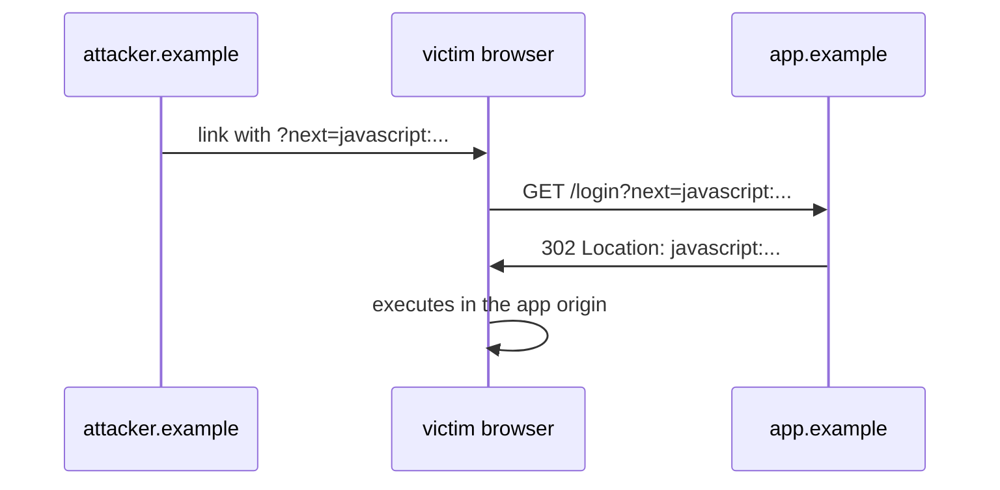
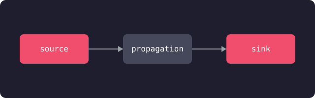

> **TL;DR**
> - Posts are page bundles: a folder with an `index.md` and its images
> - Code fences get Catppuccin Mocha syntax highlighting, ligatures disabled
> - ` ```mermaid ` fences render as diagrams, themed for light and dark
> - Images open in a zoom overlay on click
> - Frontmatter `tags`, `postKind`, and `cve` drive the chips on the list pages

This post exists so the template has something to render, and so you can see every feature in one place. Delete it once you have real content.

## Frontmatter

The fields this post uses, and what they do:

| Field | Effect |
|---|---|
| `title`, `date`, `description` | The usual. Description feeds list blurbs and meta tags |
| `tags` | Chips on list pages, taxonomy pages, palette search |
| `postKind` | The post-type chip: writeup, tool, essay, guide... |
| `cve` | Renders a red CVE chip next to the title (for security writeups) |
| `author` | Shown in the byline |

## Code blocks

Language-tagged fences are highlighted with CSS classes (Catppuccin Mocha, in both light and dark mode). Ligatures are disabled so `===` and `!==` stay three characters:

```javascript
// SOURCE: attacker-controlled input
const params = new URLSearchParams(location.search);
const next = params.get("next");

// SINK: unvalidated redirect
if (next !== null) {
  location.href = next; // javascript: URLs welcome, unfortunately
}
```

Annotated taint traces like the one above are a house style: mark the SOURCE, the PROPAGATION, and the SINK.

## Diagrams

Mermaid fences render client-side and re-theme when the visitor flips dark mode:



## Images

Images in a page bundle are referenced by filename only. Click to zoom:



*Italic caption right under the image, meme-style.*

## The rest

Blockquotes, tables, and footnotes all work as usual. The reading-progress bar at the top of this page, the hover preview cards on internal links, and the Ctrl+K palette finding this post by fuzzy title match - all free.
