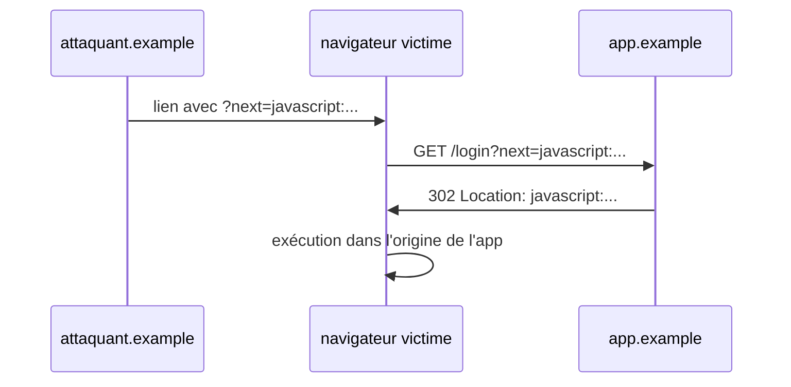

> **TL;DR**
> - Les articles sont des page bundles : un dossier avec un `index.md` et ses images
> - Les blocs de code ont la coloration Catppuccin Mocha, ligatures désactivées
> - Les blocs ` ```mermaid ` deviennent des diagrammes, thémés clair et sombre
> - Les images s'ouvrent dans un overlay de zoom au clic
> - Les champs `tags`, `postKind` et `cve` du frontmatter pilotent les chips des listes

Cet article existe pour que le template ait quelque chose à afficher, et pour montrer chaque fonctionnalité au même endroit. Supprimez-le dès que vous avez du vrai contenu.

## Frontmatter

Les champs utilisés par cet article, et leur effet :

| Champ | Effet |
|---|---|
| `title`, `date`, `description` | Le classique. La description alimente les résumés et les meta tags |
| `tags` | Chips sur les listes, pages de taxonomie, recherche de la palette |
| `postKind` | Le chip de type d'article : writeup, tool, essay, guide... |
| `cve` | Affiche un chip CVE rouge à côté du titre (pour les writeups sécurité) |
| `author` | Affiché dans la signature |

## Blocs de code

Les blocs avec un tag de langage sont colorés via des classes CSS (Catppuccin Mocha, en mode clair comme en sombre). Les ligatures sont désactivées pour que `===` et `!==` restent trois caractères :

```javascript
// SOURCE : entrée contrôlée par l'attaquant
const params = new URLSearchParams(location.search);
const next = params.get("next");

// SINK : redirection non validée
if (next !== null) {
  location.href = next; // les URLs javascript: passent, malheureusement
}
```

Les traces de taint annotées comme ci-dessus sont un style maison : marquez la SOURCE, la PROPAGATION et le SINK.

## Diagrammes

Les blocs mermaid sont rendus côté client et changent de thème quand le visiteur passe en mode sombre :



## Images

Les images d'un page bundle se référencent par leur nom de fichier seul. Cliquez pour zoomer :


*Légende en italique juste sous l'image, façon meme.*

## Le reste

Citations, tableaux et notes de bas de page fonctionnent comme d'habitude. La barre de progression de lecture en haut de cette page, les cartes de prévisualisation au survol des liens internes, et la palette Ctrl+K qui retrouve cet article en recherche floue - tout ça est fourni.
